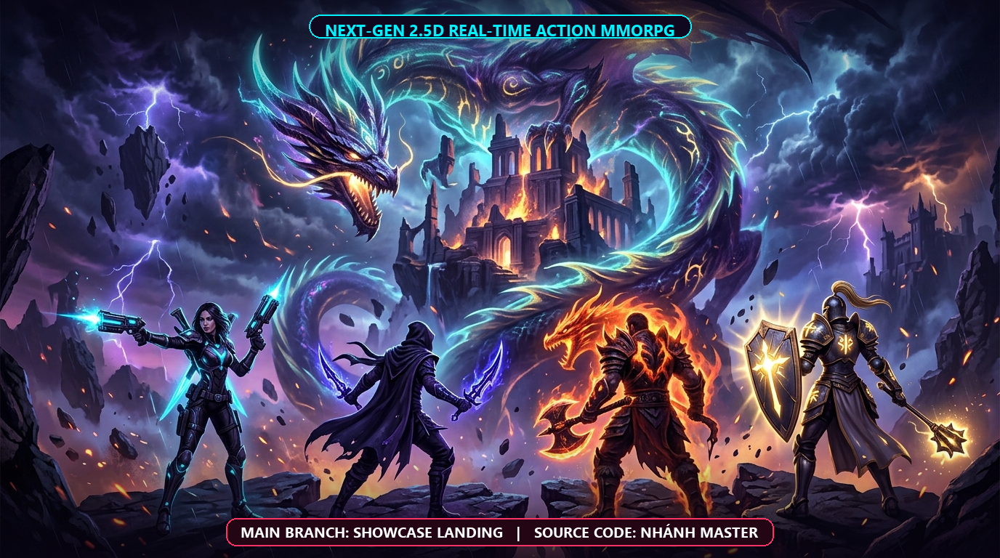

<div align="center">
  
</div>

<br/>

# 🐉 CHIẾN LONG BÍ SỬ — 2.5D Real-Time Action MMORPG
> **Realm of Legends**: Trò chơi hoàn toàn mới được kiến tạo bằng cách kết hợp cơ chế chiến đấu 3D thời gian thực (Three.js/Fiber) và chiều sâu thế giới MMORPG Dark Fantasy (Class, Trang bị, Phó bản Boss, Xếp hạng).

---

## 🌟 Những Điểm Độc Nhất Của Con Game Mới:
1. **Trải Nghiệm 3D Nhập Vai Ngay Từ Đầu**:
   - Khi vào game, bạn bước ngay vào **Thế giới 3D Làng Long Tộc & Đấu Trường Hoang Dã**.
   - Di chuyển tự do (WASD / Joystick cảm ứng), nhảy né đòn, xoay camera 360°, chiến đấu combo chém kiếm và bắn chiêu thức ma thuật theo thời gian thực.
2. **4 Hệ Phái Nhân Vật Huyền Thoại**:
   - 🎯 **Xạ Thủ (Tech Gunner)**: Tầm xa, súng năng lượng kép, đạn chùm, tên lửa hủy diệt.
   - 🗡️ **Sát Thủ (Shadow Assassin)**: Tốc độ thần sầu, dao găm bóng tối, chém chí mạng.
   - 🥊 **Đấu Sĩ (Berserk Fighter)**: Quyền cước sấm sét, nộ long quyền.
   - 🛡️ **Đỡ Đòn (Holy Guardian Tank)**: Khiên thần thánh, địa chấn, pháo đài bất tử.
3. **Tích Hợp Hệ Thống MMORPG Trực Tiếp Trong 3D**:
   - **Đồng Bộ Nhiều Người Chơi Realtime**: Gặp gỡ các anh hùng khác đang cùng phiêu lưu trong thế giới thông qua kiến trúc mạng WebSocket (20Hz Tick).
   - **Thanh trạng thái Game RPG**: Level, HP, EXP, Vàng, Chức nghiệp hiển thị mượt mà.
   - **Phó Bản Săn Boss (Dungeon Raids)**: Khiêu chiến Boss Rồng Lửa Cổ Đại tại Altar cùng đồng đội.
   - **Bảng Vinh Danh Toàn Cầu**: Theo dõi thứ hạng cao thủ server ngay trong game.
   - **Túi Đồ & Nâng Cấp Chỉ Số**: Nâng cấp vũ khí, giáp, cộng điểm tiềm năng (ATK, DEF, SPD, HP).
   - **Tự Động Đồng Bộ**: Diệt quái, nhặt vàng, tăng cấp trong 3D được đồng bộ hóa tức thì vào cơ sở dữ liệu máy chủ.
4. **Tài Liệu Đặc Tả & Kiến Trúc**:
   - Xem chi tiết bản đặc tả đầy đủ tại: [docs/PRODUCT_BRIEF.md](file:///c:/Cassavas/Game2.5D/docs/PRODUCT_BRIEF.md)
   - Quy chuẩn điều khiển công thái học: [.agents/skills/clb-control-scheme/SKILL.md](file:///c:/Cassavas/Game2.5D/.agents/skills/clb-control-scheme/SKILL.md)
   - Quy chuẩn tạo hình 2.5D Pixel: [.agents/skills/clb-character-art-style/SKILL.md](file:///c:/Cassavas/Game2.5D/.agents/skills/clb-character-art-style/SKILL.md)
5. **Trải Nghiệm Nhanh 1-Click (Quick Play)**:
   - Hỗ trợ nút **"⚡ Vào Chơi Ngay"** không cần đăng ký phức tạp.

---

## 🚀 Khởi Động Nhanh

### 1. Chạy với Docker (Khuyên Dùng):
```bash
docker compose up --build
```
Truy cập game tại: `http://localhost:8080`

Xem chi tiết tại: [DOCKER_GUIDE.md](file:///c:/Cassavas/Game2.5D/DOCKER_GUIDE.md)

### 2. Triển khai máy chủ thật Beta lên Vercel:
```bash
npx vercel --prod
```
Xem chi tiết tại: [VERCEL_GUIDE.md](file:///c:/Cassavas/Game2.5D/VERCEL_GUIDE.md)

### 3. Chạy cục bộ với pnpm:
```bash
pnpm install
pnpm run build:server
pnpm run build:game
pnpm run start
```
