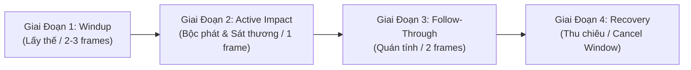

# GIÁO TRÌNH HOẠT ẢNH PIXEL ART 2.5D (PIXEL ART ANIMATION TUTORIAL)
## Dự Án: Chiến Long Bá (`@workspace/mmorpg-game`)

---

## 1. GIỚI THIỆU & TRIẾT LÝ HOẠT HỌA 2.5D ACTION RPG

Trong thế giới của **Chiến Long Bá**, đồ họa pixel không đơn thuần là những chấm màu tĩnh mà là một hệ thống chuyển động chiến đấu tốc độ cao, dứt khoát và giàu uy lực. 

Khác với hoạt hình truyền thống phải vẽ lại từng khung hình từ đầu (Frame-by-frame) tốn hàng tuần lễ, kiến trúc **Modular Pixel Rig** của dự án cho phép:
1. **Phân tách nhân vật thành 17 bộ phận độc lập** (Đầu, tóc, ngực, cơ bụng 6 múi, hông, vai, cẳng tay, bàn tay, đùi, bắp chân, ủng chiến, binh khí, khăn quàng).
2. **Xoay khớp xương theo thời gian thực (FK - Forward Kinematics)** trong phòng mô hình 3D `http://localhost:3000/character-environment`.
3. **Xem trước tư thế, xuất file JSON cấu hình** và đồng bộ trực tiếp vào Spritesheet 9 hàng chuẩn hoặc Engine game Three.js.

---

## 2. CẤU TRÚC 17 BỘ PHẬN ĐÃ PHÂN TÁCH (MODULAR ASSETS)

Toàn bộ các tệp PNG đã được bóc tách và lưu sẵn tại thư mục:  
`artifacts/mmorpg-game/public/assets/character-environment/modular-parts/`

| STT | Tên Tệp PNG | Bộ Phận | Gốc Toạ Độ Xoay (Pivot Point) | Ghi Chú Tạo Hình |
| :---: | :--- | :--- | :--- | :--- |
| 1 | `part_head.png` | Đầu & Khuôn mặt | Đáy cổ `(0, -0.2)` | Anime Heroic, mắt có catchlight trắng |
| 2 | `part_hair.png` | Mái tóc đỏ/bạch kim | Đỉnh đầu `(0, 0.3)` | Đung đưa theo gió khi di chuyển |
| 3 | `part_torso.png` | Ngực & Giáp vai | Tim / Giữa ngực `(0, 0)` | Nở ra khi hít thở, vặn khi vung kiếm |
| 4 | `part_abs.png` | Bụng 6 múi | Dưới rốn `(0, -0.15)` | Cuộn sóng theo từng thế vung đao |
| 5 | `part_hips.png` | Hông & Thắt lưng ngọc | Trọng tâm gốc `(0, 0)` | Tâm điểm xoay của toàn bộ thân dưới |
| 6 | `part_left_arm.png` | Bắp tay trái | Khớp vai trái `(-0.25, 0.2)` | Nâng/hạ khi thủ hoặc vung tay |
| 7 | `part_left_forearm.png`| Cẳng tay trái | Khuỷu tay trái `(-0.15, 0)` | Gập góc khi chạy hoặc phòng thủ |
| 8 | `part_right_arm.png` | Bắp tay phải | Khớp vai phải `(0.25, 0.2)` | Tay phát lực chính cho kiếm thuật |
| 9 | `part_right_forearm.png`| Cẳng tay & Bàn tay | Khuỷu tay phải `(0.15, 0)` | Gắn liền chuôi đao |
| 10 | `part_weapon_main.png` | Đại Đao / Thần Kiếm | Chuôi cầm `(0, -0.4)` | Vẽ vệt đao khí (Swoosh Trail) |
| 11 | `part_weapon_offhand.png`| Đoản đao / Khiên | Bàn tay phụ `(0, 0)` | Trang bị phụ của hệ Hộ Vệ / Sát Thủ |
| 12 | `part_left_thigh.png` | Đùi trái | Khớp háng trái `(-0.12, 0)` | Bước chân, góc xoay -1.0 đến +1.0 |
| 13 | `part_left_shin.png` | Bắp chân trái | Đầu gối trái `(0, 0.2)` | Gập góc nhọn khi co chân chạy |
| 14 | `part_left_foot.png` | Bàn chân & Ủng trái | Cổ chân trái `(0, 0)` | Bám đất hoặc nhấc gót |
| 15 | `part_right_thigh.png` | Đùi phải | Khớp háng phải `(0.12, 0)` | Chân trụ phát lực đòn chém |
| 16 | `part_right_shin.png` | Bắp chân phải | Đầu gối phải `(0, 0.2)` | Chịu lực trong giai đoạn Down |
| 17 | `part_scarf_cape.png` | Khăn quàng lửa | Cổ sau `(0, 0.2)` | Hiệu ứng vải bay tạo khí chất hào hiệp |

---

## 3. NGUYÊN TẮC 4 GIAI ĐOẠN ĐÒN ĐÁNH (THE 4 COMBAT ACTION PHASES)

Mỗi đòn đánh kiếm thuật trong Chiến Long Bá bắt buộc phải tuân thủ nghiêm ngặt 4 giai đoạn gia tốc:



### Chi Tiết Từng Giai Đoạn & Thông Số Góc Xoay Mẫu

#### Giai Đoạn 1: Lấy Thế (Windup / Anticipation)
- **Cơ chế:** Trọng tâm ngả lùi, vặn eo ngược chiều chém, co hai đầu gối, rút binh khí ra sau để dồn thế năng.
- **Thời lượng:** 2 - 3 khung hình ở 14 FPS.
- **Thông số góc xoay (Radians):**
  - `torsoLean`: `-0.22` (ngả lưng sau)
  - `torsoTwist`: `-0.35` (vặn eo lấy đà)
  - `headPitch`: `0.15` (mắt nhìn gườm mục tiêu)
  - `rightShoulderPitch`: `-1.10` (rút kiếm ra sau)
  - `rightElbow`: `0.95` (gập sâu khuỷu tay chuẩn bị búng)
  - `weaponAngle`: `-1.80` (giương cao mũi kiếm)
  - `leftShoulderPitch`: `0.60` (tay trái giơ trước giữ cân bằng)
  - `leftKnee`: `0.65`, `rightKnee`: `0.30`

#### Giai Đoạn 2: Bộc Phát Sát Thương (Active Impact / Hitbox & Slash Arc)
- **Cơ chế:** Thân người lao tới với vận tốc tối đa, eo vặn cực đại, cánh tay vung hết biên độ. Tại khung hình này, hệ thống kích hoạt **Hitbox gây sát thương** và xuất hiện **vệt đao khí trăng khuyết**.
- **Thời lượng:** Chỉ 1 - 2 khung hình (diễn ra chớp nhoáng).
- **Thông số góc xoay (Radians):**
  - `torsoLean`: `0.38` (đổ dồn trọng tâm về trước)
  - `torsoTwist`: `0.45` (vặn xoay eo phát lực)
  - `headPitch`: `-0.10` (hướng theo đòn đánh)
  - `rightShoulderPitch`: `0.85` (vung tay kiếm bứt phá)
  - `rightElbow`: `0.15` (cánh tay duỗi thẳng)
  - `weaponAngle`: `0.65` (mũi kiếm vạt ngang)
  - `leftShoulderPitch`: `-0.70` (tay trái giật lùi tạo phản lực)
  - `leftKnee`: `0.45`, `rightKnee`: `0.10`
  - `scarfWave`: `0.85` (khăn quàng bùng lên theo vệt chém)

#### Giai Đoạn 3: Quán Tính (Follow-Through)
- **Cơ chế:** Thân người và lưỡi đao vươn dài hết tầm quán tính trước khi hãm tốc độ. Vạt áo và tóc bay cuộn sóng theo chiều vung.
- **Thời lượng:** 2 khung hình.
- **Thông số góc xoay (Radians):**
  - `torsoLean`: `0.25`
  - `torsoTwist`: `0.55`
  - `rightShoulderPitch`: `1.25` (tay vươn dài tới hạn)
  - `weaponAngle`: `0.95` (mũi kiếm chúc xuống)
  - `scarfWave`: `0.50`

#### Giai Đoạn 4: Thu Chiêu & Hủy Đòn (Recovery / Cancel Window)
- **Cơ chế:** Nhân vật hạ đao về thế thủ trước ngực. Đây là cửa sổ cho phép người chơi bấm phím đòn tiếp theo để **Animation Canceling**, tiếp nối chuỗi combo mượt mà không bị khựng lại.
- **Thời lượng:** 2 khung hình.
- **Thông số góc xoay (Radians):**
  - `torsoLean`: `0.05`
  - `torsoTwist`: `0.10`
  - `rightShoulderPitch`: `-0.15`
  - `weaponAngle`: `-0.55` (kiếm chéo trước ngực)
  - `leftShoulderPitch`: `0.20`

---

## 4. CHU KỲ BƯỚC CHẠY CHIẾN ĐẤU (RUN CYCLE - 12 FPS)

Chu kỳ chạy chuẩn gồm 8 frames tuân thủ nguyên tắc 4 mốc then chốt:

```
Frame 0 (Right Contact) ──> Frame 2 (Right Down) ──> Frame 4 (Left Passing) ──> Frame 6 (Left Contact)
```

1. **Contact (Tiếp đất):** Gót chân trước chạm sàn, chân sau duỗi thẳng hết cỡ. Tay đối diện vung ra trước (Chân phải bước tới thì Tay trái vung trước).
2. **Down (Hạ trọng tâm):** Trọng tâm hạ thấp nhất 2px (Squash). Đầu gối chân trước gập chịu toàn bộ trọng lượng cơ thể.
3. **Passing (Lướt qua):** Chân sau co đầu gối nhấc cao lướt qua chân trụ. Thân người bắt đầu nẩy lên.
4. **Up (Bay khỏi đất):** Chân trụ đẩy mạnh nâng toàn bộ thân người lên cao nhất trước khi chân kia tiếp đất.

---

## 5. KỸ THUẬT SMEAR FRAMES & VỆT ĐAO KHÍ (SWOOSH TRAILS)

Trong pixel art, các đòn đánh tốc độ cao không thể vẽ từng chi tiết chuyển động vì mắt người sẽ thấy bị giật (strobe effect). Giải pháp là **Smear Frame** (Khung hình vệt mờ):

1. **Quỹ đạo hình cung (Arc of Motion):** Đường vung kiếm luôn là hình vòng cung 120 - 180 độ.
2. **Quy tắc 2 lớp màu tương phản:**
   - **Lõi trong (Core):** Trắng tinh khiết (`#FFFFFF`) thể hiện vận tốc xé gió và năng lượng cực điểm.
   - **Viền ngoài (Outer Aura):** Phát sáng theo màu nguyên tố của hệ phái:
     - **Chiến Binh:** Đỏ Lửa Rồng (`#EF4444`) & Cam Cháy (`#F97316`).
     - **Hộ Vệ:** Hoàng Kim Thần Thánh (`#FACC15`) & Bạc.
     - **Sát Thủ:** Tím Tinh Vân Ảnh Tộc (`#A855F7`).
     - **Xạ Thủ:** Lượng Tử Plasma Cyan (`#00F2FF`).

---

## 6. HƯỚNG DẪN SỬ DỤNG TRÊN GIAO DIỆN PHÒNG MÔ HÌNH

1. Mở trình duyệt truy cập: `http://localhost:3000/character-environment`
2. Bấm vào nút **"Giáo Trình Hoạt Ảnh (Tutorial)"** màu gradient ở góc trên bên phải hoặc thanh công cụ bên trái.
3. Trong bảng giáo trình:
   - Đọc các lý thuyết và mẹo nhà nghề.
   - Bấm nút **"Áp Dụng Pose Này Lên Model"** để trực tiếp thấy nhân vật trong không gian 3D thay đổi theo đúng góc xoay mẫu.
   - Thử nghiệm kéo thanh trượt **"Tách Rời Bộ Phận (Explode Slider)"** từ 0% đến 100% để quan sát mối liên kết giữa các khớp xương.
4. Bấm **"Sao Chép JSON"** hoặc **"Tải File .JSON"** để mang bộ thông số góc xoay vừa tạo vào dự án của bạn!

